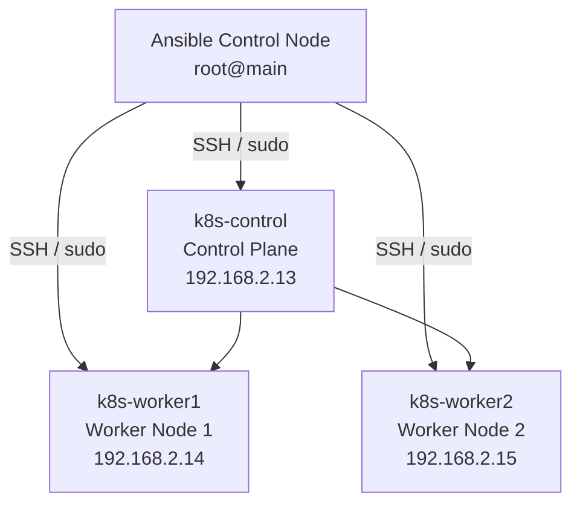
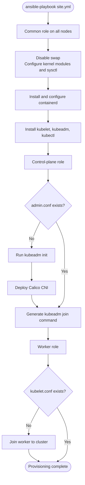
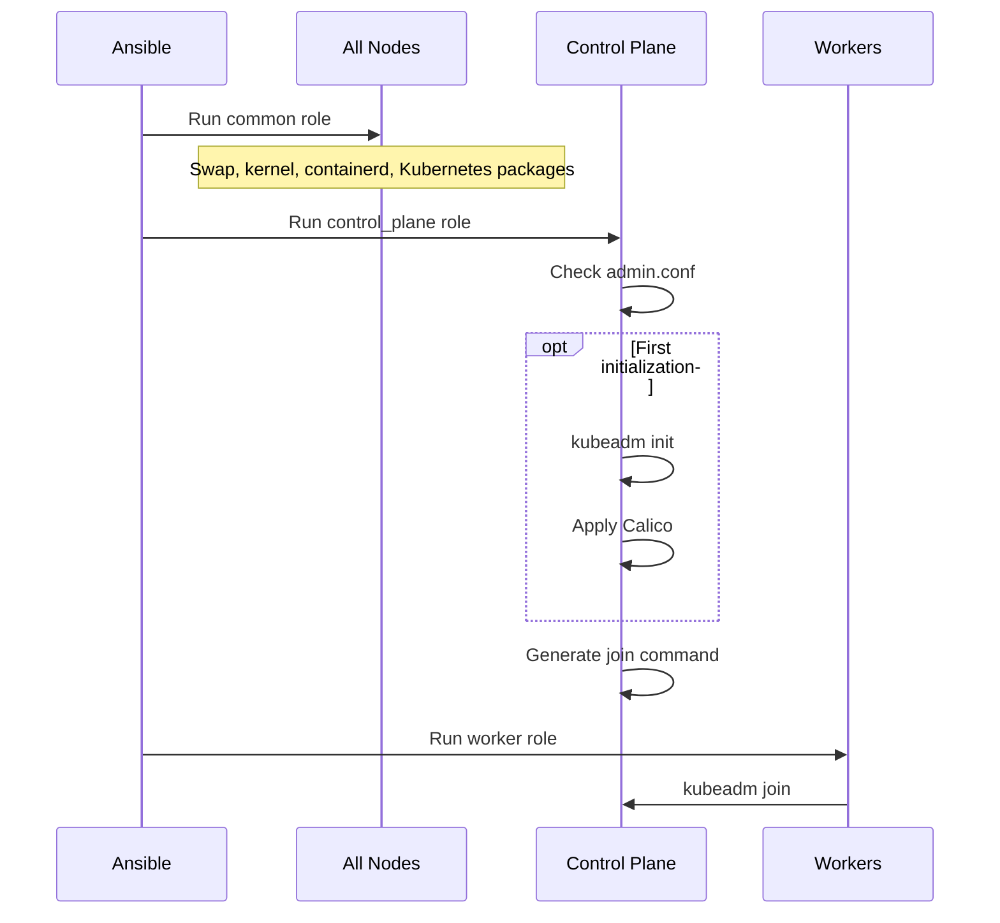

# Kubernetes Automated Provisioning with Ansible


An Infrastructure as Code (IaC) project that automates the provisioning of a multi-node Kubernetes cluster on bare-metal Ubuntu servers using **Ansible**, **containerd**, **kubeadm**, and **Calico**.

## 1. Project Overview

This repository automates the initial setup of a Kubernetes cluster. Ansible applies a common baseline to every node, initializes the control plane, deploys the Calico CNI, and joins worker nodes.

- **Common role:** disables swap, configures kernel networking, installs containerd and Kubernetes packages.
- **Control Plane role:** runs `kubeadm init`, configures the `david` user's kubeconfig, deploys Calico, and generates a worker join command.
- **Worker role:** joins each worker to the cluster.

## 2. Architecture

### 2.1 Infrastructure Architecture



### 2.2 Provisioning Workflow



### 2.3 Cluster Network

| Setting | Value |
|---|---|
| Pod network CIDR | `192.168.0.0/16` |
| CNI | Calico `v3.27.3` |
| Container runtime | containerd |
| Cgroup driver | systemd |

## 3. Node Specifications

| Hostname | Role | SSH user | IP address |
|---|---|---|---|
| `k8s-control` | Control Plane | `david` | `192.168.2.13` |
| `k8s-worker1` | Worker Node 1 | `david` | `192.168.2.14` |
| `k8s-worker2` | Worker Node 2 | `david` | `192.168.2.15` |

The Ansible control node is separate from the Kubernetes nodes.

## 4. Repository Structure

```text
k8s-ansible-iac/
├── ansible.cfg
├── site.yml
├── inventory/
│   └── hosts.ini
├── group_vars/
│   └── all.yml
└── roles/
    ├── common/
    │   ├── handlers/main.yml
    │   └── tasks/main.yml
    ├── control_plane/
    │   └── tasks/main.yml
    └── worker/
        └── tasks/main.yml
```

## 5. Configuration

### 5.1 Ansible Configuration

`ansible.cfg` defines the inventory, SSH user and key, and privilege escalation defaults.

```ini
[defaults]
inventory = ./inventory/hosts.ini
host_key_checking = False
remote_user = david
private_key_file = /root/.ssh/id_ed25519
python_interpreter = /usr/bin/python3

[privilege_escalation]
become = True
become_method = sudo
become_user = root
become_ask_pass = False
```

### 5.2 Inventory

```ini
[control_plane]
k8s-control ansible_host=192.168.2.13

[workers]
k8s-worker1 ansible_host=192.168.2.14
k8s-worker2 ansible_host=192.168.2.15

[k8s_cluster:children]
control_plane
workers
```

### 5.3 Cluster Variables

`group_vars/all.yml` centralizes the Kubernetes version and network settings.

```yaml
---
k8s_version: "1.30"
k8s_apt_version: "1.30.0-1.1"
pod_network_cidr: "192.168.0.0/16"
control_plane_ip: "192.168.2.13"
```

## 6. Ansible Roles

### 6.1 Common Role

The `common` role runs on every Kubernetes node.

| Task | Purpose |
|---|---|
| Disable swap | Runs `swapoff -a` and comments swap entries in `/etc/fstab` |
| Kernel modules | Configures and loads `overlay` and `br_netfilter` |
| Network sysctl | Enables bridge netfilter and IPv4 forwarding |
| Prerequisites | Installs `apt-transport-https`, `ca-certificates`, `curl`, `gnupg`, and `lsb-release` |
| Container runtime | Installs containerd and enables `SystemdCgroup` |
| Kubernetes repository | Adds the Kubernetes APT signing key and repository |
| Kubernetes packages | Installs pinned versions of kubelet, kubeadm, and kubectl |
| Package hold | Prevents automatic upgrades of Kubernetes packages |
| kubelet service | Enables kubelet at boot |

The containerd configuration is generated from its default configuration, then `SystemdCgroup` is changed to `true`. A handler restarts containerd when notified.

### 6.2 Control Plane Role

The control-plane role checks for `/etc/kubernetes/admin.conf`. If it does not exist, the role initializes the cluster with `kubeadm init`, using the configured API server address and pod CIDR. It then:

1. Creates `/home/david/.kube`.
2. Copies `admin.conf` to `/home/david/.kube/config`.
3. Applies the Calico `v3.27.3` manifest on first initialization.
4. Generates a worker join command with `kubeadm token create --print-join-command`.
5. Stores the command as an Ansible fact for the worker role.

### 6.3 Worker Role

The worker role checks for `/etc/kubernetes/kubelet.conf`.

- If the file exists, the worker is treated as already joined.
- If it does not exist, the role executes the join command generated by the control-plane role.

## 7. Playbook Execution Order



The top-level `site.yml` orchestrates the roles in this order:

```yaml
---
- name: Execute Common Setup on All Nodes
  hosts: k8s_cluster
  become: true
  roles:
    - common

- name: Setup Control Plane Node
  hosts: control_plane
  become: true
  roles:
    - control_plane

- name: Join Worker Nodes to Cluster
  hosts: workers
  become: true
  roles:
    - worker
```

## 8. Quick Start

### 8.1 Prerequisites

- Ansible installed on the control node.
- Ubuntu servers reachable over the network.
- Passwordless SSH access from the control node to `david` on all target nodes.
- Passwordless sudo for `david` on all target nodes.
- The private key available at `/root/.ssh/id_ed25519` on the control node.
- Hostnames and IP addresses configured as shown in the inventory.

### 8.2 Test Connectivity

```bash
ansible all -m ping
```

### 8.3 Execute the Playbook

Run from the repository root. The inventory is configured in `ansible.cfg`.

```bash
ansible-playbook site.yml
```

Alternatively, specify the inventory explicitly:

```bash
ansible-playbook -i inventory/hosts.ini site.yml
```

### 8.4 Verify the Cluster

```bash
ssh david@192.168.2.13 "kubectl get nodes -o wide"
ssh david@192.168.2.13 "kubectl get pods -A"
```

## 9. Idempotency and Re-run Behavior

The playbook includes checks to avoid repeating some initialization operations:

- Control-plane initialization is skipped when `/etc/kubernetes/admin.conf` exists.
- Worker joining is skipped when `/etc/kubernetes/kubelet.conf` exists.
- Kubernetes package versions are pinned and held.

These checks make some operations safe to repeat, but not every task is fully idempotent. For example, the containerd task regenerates the default configuration whenever the common role runs. Review task behavior before using this playbook in production.

## 10. Security and Operational Notes

- `host_key_checking = False` disables SSH host-key verification. This is convenient in a lab but weakens protection against host impersonation.
- The playbook expects passwordless sudo for the `david` account.
- `/home/david/.kube/config` is copied from the privileged `admin.conf` and should be treated as a sensitive cluster credential.
- The generated `kubeadm join` command contains a bootstrap token and should be handled as sensitive data.
- Kubernetes package versions are pinned and held. Plan upgrades deliberately.
- Confirm Kubernetes and Calico version compatibility before changing either version.

This is a lab / portfolio provisioning example. A production deployment requires additional design for high availability, backups, secrets management, certificate lifecycle, monitoring, and disaster recovery.

## 11. Project Scope

The playbook automates initial provisioning of a single-control-plane Kubernetes cluster with two worker nodes.

Included:

- OS-level Kubernetes prerequisites.
- containerd installation and cgroup configuration.
- kubelet, kubeadm, and kubectl installation.
- Control-plane bootstrap with kubeadm.
- Calico CNI deployment.
- Worker node joining.

Application deployment, persistent storage, ingress, monitoring, logging, backups, and cluster upgrades are outside the scope of the playbook shown here.

## 12. Author

Maintained as a personal Kubernetes and Ansible Infrastructure as Code portfolio project.
